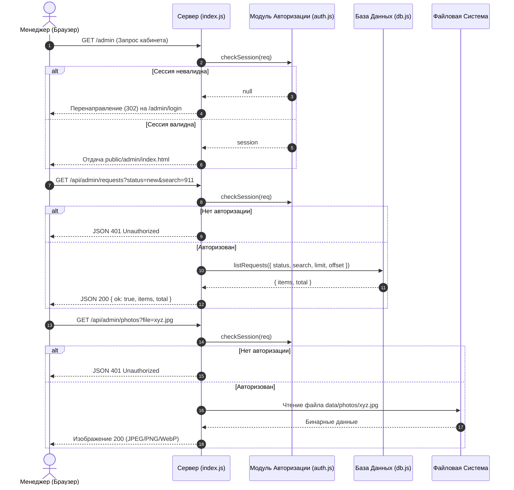

# Шаг 3.6. Кабинет менеджера с детальными фильтрами (Техническое задание)

Этот документ описывает техническое задание на создание и интеграцию личного кабинета менеджера (админ-панели). Все функции реализуются на чистом Node.js и ванильном JavaScript, без использования сторонних фреймворков и NPM-пакетов.

---

## 1. Архитектурная схема взаимодействия (Mermaid)

---

## 2. Функциональные требования

### 2.1. Доработка Базы Данных (`server/db.js`)
В `server/db.js` необходимо расширить функционал получения списка заявок и удаления заявок.

1. **Поиск по телефону или имени в `listRequests`**:
   * Добавить поддержку поискового запроса `search` (строка).
   * Если `search` передан, то фильтровать записи: `WHERE (phone LIKE ? OR name LIKE ?)` (сопоставление подстроки без учёта регистра: `%search%`).
   * Совместить поиск со статусом: если выбраны и статус, и поиск, запрос должен быть: `WHERE status = ? AND (phone LIKE ? OR name LIKE ?)`.
   * Для реализации можно динамически формировать SQL-запрос или подготовить дополнительные SQL-выражения (`stmts`) внутри `prepareStatements()`. Пример:
     * `listAllWithSearch`: `SELECT ... FROM requests WHERE (phone LIKE ? OR name LIKE ?) ORDER ...`
     * `listByStatusWithSearch`: `SELECT ... FROM requests WHERE status = ? AND (phone LIKE ? OR name LIKE ?) ORDER ...`
     * Соответствующие счётчики `countAllWithSearch` и `countByStatusWithSearch`.

2. **Метод удаления заявки `deleteRequest(id)`**:
   * Удаляет запись из таблицы `requests` по её `id`.
   * Из-за каскадного удаления (`ON DELETE CASCADE`) СУБД SQLite автоматически удалит связанные строки в таблицах `photos` и `notifications`.
   * Метод должен выполняться в транзакции и возвращать список имён файлов картинок (`file_name`), ассоциированных с этой заявкой, чтобы сервер мог безопасно стереть их с жёсткого диска.

---

### 2.2. Серверные API-маршруты (`server/index.js`)

Все маршруты под префиксом `/api/admin/*` должны проверять авторизацию через `auth.checkSession(req)`. Если сессия невалидна, возвращать статус `401 Unauthorized` с JSON: `{"ok": false, "error": "Необходима авторизация"}`.

1. **Безопасность статических файлов**:
   * Маршрут `/admin` и `/admin/` должен отдавать файл `public/admin/index.html` только при наличии активной сессии. Иначе — редирект на `/admin/login`.
   * Предотвратить прямой неавторизованный доступ к файлам кабинета через автоподстановку в `serveStatic`. Если `pathname` начинается с `/admin/` (за исключением `/admin/login.*`), сервер должен проверять сессию. При отсутствии сессии — редирект на `/admin/login`.

2. **Получение списка заявок с пагинацией и фильтрами (`GET /api/admin/requests`)**:
   * Принимает query-параметры:
     * `status` — строка (опционально, фильтр по статусу).
     * `search` — строка (опционально, поиск по телефону или имени).
     * `limit` — число (опционально, лимит элементов на странице, по умолчанию 20).
     * `offset` — число (опционально, смещение, по умолчанию 0).
   * Вызывает `db.listRequests(...)` и возвращает список заявок и общее число совпадений для пагинации.

3. **Изменение статуса заявки (`POST /api/admin/requests/:id/status`)**:
   * Принимает JSON: `{ "status": "in_progress" | "done" | "cancelled" | "new" }`.
   * Изменяет статус в базе данных с помощью `db.setRequestStatus(id, status)`.
   * Возвращает `{ "ok": true }` или ошибку при неверном статусе.

4. **Удаление заявки (`POST /api/admin/requests/:id/delete` или метод `DELETE`)**:
   * Вызывает удаление из базы данных.
   * Получает список удалённых файлов картинок.
   * Стирает физические файлы из директории `data/photos/`.
   * Возвращает `{ "ok": true }`.

5. **Защищённый стриминг фотографий (`GET /api/admin/photos`)**:
   * Принимает query-параметр: `?file=имя_файла.jpg`.
   * Защищает от уязвимости Path Traversal: имя файла должно быть очищено и проверено (без `/`, `\`, `..`).
   * Проверяет существование файла в папке `data/photos/`.
   * Отдаёт файл с правильным MIME-типом (`image/jpeg`, `image/png` или `image/webp`).

---

### 2.3. Интерфейс Кабинета Менеджера (`public/admin/`)

Создаются два новых файла:
1. `public/admin/index.html` — разметка личного кабинета.
2. `public/admin/index.js` — интерактивная логика.
И расширяются/создаются стили `public/admin/index.css` (или используется общий файл, либо создаётся новый `public/admin/dashboard.css`).

#### Требования к UI кабинета:
1. **Единый стиль бренда**:
   * Точно так же, как и форма логина, страница кабинета при загрузке запрашивает `../config.json` и окрашивает ключевые элементы (кнопки, активные фильтры, шапку) в цвета `--primary` и `--accent`.
   * Отображает `companyName` в верхнем меню (хедере).

2. **Панель фильтров и поиска**:
   * **Поиск**: Поле ввода для поиска по имени или телефону. Поиск должен срабатывать «на лету» (с дебаунсом в 300–500 мс) либо по нажатию кнопки «Найти»/Enter.
   * **Фильтр статусов**: Кнопки-вкладки или выпадающий список со статусами («Все», «Новые», «В работе», «Выполнены», «Отклонены»). У каждого статуса отображается счётчик количества заявок (опционально) или просто активный визуальный стиль для выбранной вкладки.
   * Кнопка «Сбросить фильтры».

3. **Список заявок (Сетка или Карточки)**:
   * Каждая карточка заявки содержит:
     * Номер и красивую дату создания (например, через `toLocaleString('ru-RU')`).
     * Статус в виде цветного бейджа (Новый — синий, В работе — оранжевый, Выполнен — зелёный, Отклонен — серый).
     * Выпадающий список или группу кнопок для мгновенного изменения статуса заявки.
     * Выбранную услугу (выделено жирным) и ориентировочную стоимость.
     * ФИО клиента и кликабельный телефон (`tel:` ссылка).
     * Описание проблемы, оставленное клиентом.
     * Сетку миниатюр приложенных картинок. Картинки запрашиваются через защищённый роут `/api/admin/photos?file=...`.
   * При клике на миниатюру открывается полноэкранный Lightbox (модальное окно) для детального просмотра фото.
   * Кнопка «Удалить заявку» с подтверждением (браузерный `confirm` или стильное модальное окно).

4. **Пагинация**:
   * Если заявок больше, чем `limit` (например, 20), внизу страницы показывается кнопка «Показать ещё» или стандартный постраничный навигатор.

5. **Выход из кабинета**:
   * Кнопка «Выйти» в хедере. При нажатии отправляет `POST /api/admin/logout` и после успешного ответа перенаправляет на `/admin/login`.

---

## 3. Критерии приемки

1. **Безопасность**:
   * Без авторизации (без валидной куки) зайти на `/admin` невозможно (редирект на `/admin/login`).
   * Попытка запросить `/api/admin/requests` без авторизации отдаёт JSON со статусом `401`.
   * Картинки из папки `data/photos/` нельзя скачать напрямую без авторизации.
   * Исключена уязвимость Path Traversal при скачивании картинок менеджером.

2. **Функциональность**:
   * Смена статуса заявки на лету мгновенно сохраняется в базе данных и визуально обновляет бейдж карточки.
   * Поиск по телефону находит заявки, даже если телефон введён частично (например, `911` находит `+7 (911) 123-45-67`).
   * Поиск по имени работает аналогично.
   * При удалении заявки запись исчезает из базы данных, а файлы картинок физически стираются из папки `data/photos/`.
   * Пагинация корректно подгружает старые заявки.
