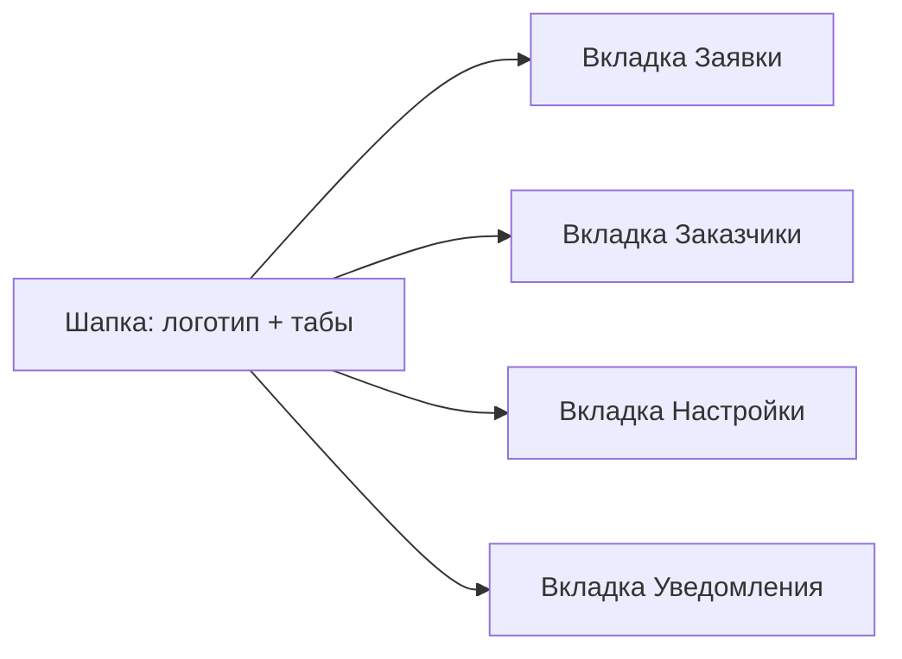

# Шаг 5 — Рабочий кабинет владельца бизнеса

Три этапа превращения текущей админки в полноценный кабинет.

---

## Обзор текущего состояния

### Что уже есть

- **БД** (`server/db.js`): таблицы `requests`, `photos`, `notifications`; поля `base_price`, `discount_value`, `discount_type`, `final_price`, `manager_note` в `requests`; функция `updateRequestPricing`; SQL-запросы SELECT пока **не возвращают** новые ценовые поля (строки 165–188 и `toRequest` строка 277).
- **API** (`server/index.js`): маршруты `GET /api/admin/requests`, `POST /api/admin/requests/:id/status`, `POST /api/admin/requests/:id/delete`, `POST /api/admin/request/update`, `POST /api/admin/logo`, `POST /api/admin/logo/delete`, логин/логаут.
- **Админка** (`public/admin/`): одна страница «Заявки» — список карточек, фильтр по статусу, поиск, смена статуса, удаление, лайтбокс фото.
- **Витрина** (`public/app.js`): функция `isRussianPhone()` для валидации, но **нет маски** ввода.
- **config.json**: `companyName`, `title`, `subtitle`, `colors`, `contacts`, `services`, `notifications`.

### Архитектура вкладок админки

Текущая админка — одностраничная. Добавим **табы-навигацию** в шапку: «Заявки», «Заказчики», «Настройки», «Уведомления». Каждая вкладка — отдельная **секция** (`<section>`) внутри того же `index.html`, переключаемая через JS (без перезагрузки страницы). Это позволяет повторно использовать общий CSS, авторизацию и шапку.



---

## Этап 1 — Маска телефона + доработка карточки заявки

Цель: умная маска на витрине и расширенная карточка заявки в админке (цена, скидка, заметки, мессенджеры, CSV).

### 1.1 Маска ввода телефона на витрине

**Файл:** `public/app.js`

**Что сделать:**

1. Добавить функцию `formatPhoneMask(rawDigits)`:
   - Принимает строку **только из цифр** (без +, пробелов, скобок).
   - Если первая цифра `8` — заменить на `7`.
   - Если первая цифра `9` — добавить `7` перед ней.
   - Форматировать по шаблону: `+7 (XXX) XXX-XX-XX`.
   - Если цифр меньше 11 — форматировать столько, сколько есть (постепенно наращивать маску по мере ввода).

2. Добавить функцию `extractDigits(value)`:
   - Убирает из строки всё кроме цифр: `value.replace(/\D/g, '')`.

3. Навесить обработчик `input` на поле `el.contact`:
   - При каждом вводе: извлечь цифры через `extractDigits`, пропустить через `formatPhoneMask`, записать обратно в `el.contact.value`.
   - Запомнить позицию курсора и восстановить её корректно после замены value (чтобы курсор не прыгал в конец).

4. Навесить обработчик `paste` на поле `el.contact`:
   - При вставке из буфера: `event.preventDefault()`, получить текст из `event.clipboardData.getData('text')`, извлечь цифры, пропустить через `formatPhoneMask`, записать в `el.contact.value`.

5. Обработчик `focus` на поле `el.contact`:
   - Если поле пустое — подставить `+7 (` как начальное значение.

6. Обработчик `blur` на поле `el.contact`:
   - Если значение содержит только `+7 (` или `+7` — очистить поле (пользователь ничего не ввёл).

7. В `validate()` при отправке формы — из `el.contact.value` извлечь только цифры (через `extractDigits`), проверить что их ровно 11 и первая — `7`. В `formData.append('phone', ...)` отправлять **отформатированное** значение `+7 (XXX) XXX-XX-XX`.

**Порядок вызова в `init()`:** после строки `el.contact = document.getElementById('contact');` навесить все обработчики маски.

**Не трогать:** функцию `isRussianPhone()` — она останется как fallback-валидация, но теперь маска гарантирует правильный формат ещё до отправки.

---

### 1.2 Расширение SQL-запросов для ценовых полей

**Файл:** `server/db.js`

**Что сделать:**

1. **Функция `toRequest` (строка 277):** добавить в возвращаемый объект поля:
   ```
   basePrice: row.base_price ?? null,
   discountValue: row.discount_value ?? null,
   discountType: row.discount_type ?? null,
   finalPrice: row.final_price ?? null,
   managerNote: row.manager_note ?? ''
   ```

2. **Все SELECT-запросы в `stmts`** (строки 165–188): к каждому SELECT, который выбирает данные заявок, добавить колонки `r.base_price, r.discount_value, r.discount_type, r.final_price, r.manager_note`. Это касается prepared statements:
   - `listAll` (строка 165)
   - `listByStatus` (строка 170)
   - `listAllWithSearch` (строка 177)
   - `listByStatusWithSearch` (строка 183)
   - `getRequest` (строка 151) — тоже добавить эти поля

3. **Новая функция `getSummary(options)`** — возвращает сводку по заявкам:
   - Принимает те же фильтры `status` и `search` (или без них).
   - Выполняет один SQL-запрос:
     ```sql
     SELECT
       COUNT(*) AS total,
       SUM(CASE WHEN status = 'new' THEN 1 ELSE 0 END) AS count_new,
       SUM(CASE WHEN status = 'in_progress' THEN 1 ELSE 0 END) AS count_in_progress,
       SUM(CASE WHEN status = 'done' THEN 1 ELSE 0 END) AS count_done,
       SUM(CASE WHEN status = 'cancelled' THEN 1 ELSE 0 END) AS count_cancelled,
       COALESCE(SUM(CASE WHEN status = 'done' THEN final_price ELSE 0 END), 0) AS revenue
     FROM requests
     ```
   - Возвращает объект `{ total, countNew, countInProgress, countDone, countCancelled, revenue }`.
   - Экспортировать в `module.exports`.

4. **Новая функция `getClients(options)`** — для вкладки «Заказчики» (подготовка для Этапа 2):
   - SQL-запрос с группировкой по нормализованному телефону:
     ```sql
     SELECT
       phone,
       MAX(name) AS name,
       COUNT(*) AS request_count,
       MAX(created_at) AS last_request_at,
       COALESCE(SUM(final_price), 0) AS total_spent,
       MIN(created_at) AS first_request_at
     FROM requests
     GROUP BY phone
     ORDER BY MAX(created_at) DESC
     LIMIT ? OFFSET ?
     ```
   - Принимает `{ search, limit, offset }`.
   - При наличии `search` — добавлять `HAVING phone LIKE ? OR MAX(name) LIKE ?`.
   - Также `getClientsCount(options)` — аналог но `SELECT COUNT(DISTINCT phone)`.
   - Экспортировать обе функции.

---

### 1.3 Новый API-маршрут для сводки

**Файл:** `server/index.js`

**Что сделать:**

1. Добавить маршрут `GET /api/admin/summary` (вставить перед блоком `if (pathname === '/api/admin/requests')`):
   - Проверка авторизации `auth.checkSession(req)`.
   - Вызвать `db.getSummary()`.
   - Ответ: `{ ok: true, summary: { total, countNew, countInProgress, countDone, countCancelled, revenue } }`.

2. Добавить маршрут `GET /api/admin/clients` (вставить после маршрута `/api/admin/requests`):
   - Проверка авторизации.
   - Параметры из query: `search`, `limit`, `offset`.
   - Вызвать `db.getClients({ search, limit, offset })`.
   - Ответ: `{ ok: true, items: [...], total: N }`.

---

### 1.4 Расширение карточки заявки в админке

**Файл:** `public/admin/index.js`

**Что сделать в функции `buildCard(item)` (строка 286):**

1. **После блока «Контакт» (строка 332)** — добавить кнопки мессенджеров:
   - Извлечь чистые цифры из `item.phone` (функция `phoneForTel`).
   - Кнопка «Telegram» — ссылка `https://t.me/+ЦИФРЫ` — `<a>` с `target="_blank"` и классом `messenger-btn tg-btn`.
   - Кнопка «WhatsApp» — ссылка `https://wa.me/ЦИФРЫ` — `<a>` с `target="_blank"` и классом `messenger-btn wa-btn`.
   - Обе кнопки в обёртке `<div class="messenger-links">`.

2. **После блока «Описание» (строка 349)** — добавить раскрывающуюся секцию «Цена и скидка»:
   - Создать `<details class="pricing-section">` с `<summary>Цена и скидка</summary>`.
   - Внутри — форма из полей:
     - `<input type="number" step="1" min="0">` для «Базовая цена» (значение из `item.basePrice`).
     - `<select>` для типа скидки: пустая опция «—», «%» (percent), «₽» (fixed). Значение из `item.discountType`.
     - `<input type="number" step="1" min="0">` для «Размер скидки» (значение из `item.discountValue`).
     - `<input type="number" step="1" min="0">` для «Итого» (значение из `item.finalPrice`). Поле должно **авто-рассчитываться**: при изменении базовой цены, типа или размера скидки — пересчитать `finalPrice` на клиенте.
     - `<textarea rows="2">` для «Заметка менеджера» (значение из `item.managerNote`).
   - Кнопка «Сохранить» — отправляет `POST /api/admin/request/update` с JSON `{ id, basePrice, discountValue, discountType, finalPrice, managerNote }`.

3. **Отметка повторного клиента:** при рендере списка, после загрузки данных в `renderList()`, подсчитать `phoneCounts` — Map телефон→количество заявок среди `state.items`. Если `phoneCounts.get(item.phone) > 1` — добавить бейдж `<span class="repeat-badge">Повторный</span>` в блок контакта.

4. **Сводка показателей:** в начале `renderList()` — загрузить `GET /api/admin/summary` и отрисовать в `el.summary`:
   - Пять счётчиков статусов в виде цветных плашек: «Новые: N», «В работе: N», «Выполнены: N», «Отклонены: N».
   - Общая выручка: «Выручка: X ₽» (только по заявкам со статусом «done»).

5. **Кнопка «Экспорт CSV»:** добавить рядом со сводкой кнопку `<button id="exportCsvBtn">Экспорт CSV</button>`.
   - При клике — собрать из `state.items` массив строк CSV (разделитель `;`, кодировка UTF-8 с BOM).
   - Колонки: ID, Дата, Имя, Телефон, Услуга, Цена от, Базовая цена, Скидка, Тип скидки, Итого, Статус, Заметка.
   - Создать Blob и скачать через `URL.createObjectURL` + временный `<a download="requests.csv">`.

**Файл:** `public/admin/index.css`

**Что добавить:**

- Стили для `.messenger-links` (flex, gap), `.messenger-btn` (inline-flex, padding, border-radius, font-size 13px), `.tg-btn` (цвет #229ED9), `.wa-btn` (цвет #25D366).
- Стили для `.pricing-section` (padding, border, border-radius), `.pricing-section summary` (cursor pointer, font-weight 700).
- Стили для `.repeat-badge` (background #fbbf24, color #78350f, font-size 11px, padding 2px 6px, border-radius 4px).
- Стили для `.summary-cards` (display flex, flex-wrap, gap 8px), `.summary-card` (padding, border-radius, font-size 14px, min-width 100px, text-align center), плашки по цветам из CSS-переменных.
- Стили для `.export-btn` (аналог `.logout-btn` но с зелёным фоном).

---

## Этап 2 — Вкладки «Заказчики» и «Настройки витрины»

Цель: навигация между вкладками, новая вкладка клиентской базы и редактирование config.json из браузера.

### 2.1 Навигация по вкладкам

**Файл:** `public/admin/index.html`

**Что сделать:**

1. В `<header>` после `.brand` и перед `logoutBtn` — добавить навигацию:
   ```html
   <nav class="admin-tabs" id="adminTabs">
     <button type="button" class="admin-tab is-active" data-tab="requests">Заявки</button>
     <button type="button" class="admin-tab" data-tab="clients">Заказчики</button>
     <button type="button" class="admin-tab" data-tab="settings">Настройки</button>
     <button type="button" class="admin-tab" data-tab="notifications">Уведомления</button>
   </nav>
   ```

2. Обернуть текущее содержимое `<main>` (всё от `configError` до `pagination`) в `<section id="tabRequests" class="tab-content">`.

3. Добавить три пустых секции:
   ```html
   <section id="tabClients" class="tab-content" hidden>...</section>
   <section id="tabSettings" class="tab-content" hidden>...</section>
   <section id="tabNotifications" class="tab-content" hidden>...</section>
   ```

**Файл:** `public/admin/index.js`

**Что сделать:**

1. В `init()` — получить ссылку на `el.adminTabs = document.getElementById('adminTabs')` и все `tab-content` секции.
2. Добавить обработчик `click` на `el.adminTabs` — при клике на кнопку:
   - Скрыть все `.tab-content` (добавить `hidden`).
   - Показать нужную секцию по `data-tab`.
   - Обновить класс `is-active` на табах.
   - При первом переключении на вкладку — загрузить её данные (lazy-load).

**Файл:** `public/admin/index.css`

**Что добавить:**

- Стили для `.admin-tabs` (display flex, gap 4px, flex-wrap wrap), `.admin-tab` (аналог `.status-tab` но в шапке — цвет белый/полупрозрачный фон).

---

### 2.2 Вкладка «Заказчики»

**Файл:** `public/admin/index.html` — содержимое секции `#tabClients`:

```html
<div class="search-field">
  <label for="clientSearch">Поиск клиента</label>
  <input type="search" id="clientSearch" placeholder="Имя или телефон" autocomplete="off">
</div>
<div id="clientsSummary" class="summary" hidden></div>
<div id="clientsList" class="clients-list"></div>
<div id="clientsEmpty" class="empty-state" hidden>Клиентов не найдено.</div>
<div class="pagination">
  <button type="button" id="clientsLoadMore" class="load-more-btn" hidden>Показать ещё</button>
</div>
<button type="button" id="exportClientsCsv" class="export-btn">Экспорт клиентов CSV</button>
```

**Файл:** `public/admin/index.js`

**Что сделать:**

1. Новый объект `clientsState` (аналог `state`, но для клиентов): `{ search, offset, total, items, loading, hasMore }`.
2. Функция `loadClients()` — `GET /api/admin/clients?search=...&limit=20&offset=...`. Формат ответа: `{ ok, items: [{ phone, name, requestCount, lastRequestAt, totalSpent, firstRequestAt }], total }`.
3. Функция `renderClients()` — для каждого клиента рисовать карточку `<article class="client-card">`:
   - Имя, телефон (ссылка `tel:`).
   - Количество обращений, сумма заказов.
   - Дата первого и последнего обращения.
   - Кнопки Telegram / WhatsApp (аналогично заявкам).
4. Поиск по клиентам — `debounce` на `#clientSearch`.
5. Пагинация — кнопка «Показать ещё».
6. Экспорт в CSV — по аналогии с заявками, колонки: Телефон, Имя, Кол-во заявок, Сумма, Первое обращение, Последнее обращение.

---

### 2.3 Вкладка «Настройки витрины»

**Файл:** `server/index.js`

**Что добавить — два новых маршрута:**

1. `GET /api/admin/config` — читает `public/config.json` через `fs.readFileSync`, отдаёт `{ ok: true, config: {...} }`. Проверка авторизации.

2. `POST /api/admin/config` — принимает JSON с полным или частичным объектом config:
   - Проверка авторизации.
   - Принять тело (`readJsonBody`).
   - **Валидация:**
     - `companyName` — строка, обрезать, максимум 100 символов.
     - `title` — строка, максимум 200 символов.
     - `subtitle` — строка, максимум 500 символов.
     - `colors.primary`, `colors.accent` — строки, соответствующие `/^#([0-9a-fA-F]{3}|[0-9a-fA-F]{6})$/`.
     - `contacts.phone` — строка, максимум 30 символов.
     - `contacts.telegram`, `contacts.whatsapp`, `contacts.max` — строки, `https://` URL или пустая строка, максимум 200 символов.
     - `services` — массив объектов `{ name: string, priceFrom: number }`. Максимум 30 элементов. `name` — непустая строка до 100 символов. `priceFrom` — целое неотрицательное число.
   - Прочитать текущий `config.json`, смержить с переданными полями, записать `fs.writeFileSync` в `public/config.json`.
   - Ответ: `{ ok: true }`.

**Файл:** `public/admin/index.html` — содержимое секции `#tabSettings`:

```html
<h2>Данные компании</h2>
<div class="settings-group">
  <label>Название компании <input type="text" id="cfgCompanyName"></label>
  <label>Заголовок <input type="text" id="cfgTitle"></label>
  <label>Подзаголовок <textarea id="cfgSubtitle" rows="2"></textarea></label>
</div>

<h2>Фирменные цвета</h2>
<div class="settings-group colors-group">
  <label>Основной <input type="color" id="cfgColorPrimary"> <input type="text" id="cfgColorPrimaryHex" maxlength="7" placeholder="#319795"></label>
  <label>Акцент <input type="color" id="cfgColorAccent"> <input type="text" id="cfgColorAccentHex" maxlength="7" placeholder="#4fd1c5"></label>
</div>

<h2>Контакты</h2>
<div class="settings-group">
  <label>Телефон <input type="tel" id="cfgPhone"></label>
  <label>Telegram <input type="url" id="cfgTelegram" placeholder="https://t.me/..."></label>
  <label>WhatsApp <input type="url" id="cfgWhatsapp" placeholder="https://wa.me/..."></label>
  <label>MAX <input type="url" id="cfgMax" placeholder="https://max.ru/..."></label>
</div>

<h2>Логотип</h2>
<div class="settings-group">
  
  <input type="file" id="cfgLogoFile" accept="image/jpeg,image/png,image/webp">
  <button type="button" id="cfgLogoUpload">Загрузить</button>
  <button type="button" id="cfgLogoDelete">Удалить</button>
</div>

<h2>Услуги</h2>
<div id="cfgServicesList" class="services-editor"></div>
<button type="button" id="cfgAddService" class="add-service-btn">+ Добавить услугу</button>

<div class="settings-actions">
  <button type="button" id="cfgSaveBtn" class="save-btn">Сохранить настройки</button>
  <span id="cfgSaveStatus"></span>
</div>
```

**Файл:** `public/admin/index.js`

**Что сделать:**

1. Функция `loadSettings()` — `GET /api/admin/config`. Заполнить все поля формы значениями из ответа.
2. Редактор услуг — динамический список. Каждая услуга — строка с `<input name>`, `<input priceFrom>`, кнопка «Удалить». Кнопка `#cfgAddService` добавляет пустую строку.
3. Синхронизация `<input type="color">` ↔ `<input type="text">` для цветов (при изменении одного — обновлять другой).
4. Логотип — использовать существующие маршруты `POST /api/admin/logo` и `POST /api/admin/logo/delete`. Превью: `GET /api/admin/logo/current` (если нужно — добавить маршрут для отдачи текущего лого, или просто использовать `/branding/logo.*`).
5. Кнопка «Сохранить» — собрать все значения в объект, отправить `POST /api/admin/config`.
6. При успехе — показать «✓ Сохранено» рядом с кнопкой на 3 секунды.

**Файл:** `public/admin/index.css`

**Что добавить:**

- Стили для `.settings-group` (display flex, flex-direction column, gap 12px), `.settings-group label` (display flex, flex-direction column, gap 4px, font-weight 600, font-size 14px).
- Стили для `.colors-group label` (flex-direction row, align-items center, gap 8px).
- Стили для `.services-editor` — каждая строка `.service-row` (display flex, gap 8px, align-items center).
- Стили для `.save-btn` (background var(--primary), color #fff, padding 12px 24px, border-radius 8px, font-weight 700).
- Стили для `.add-service-btn` (border dashed, padding 8px).
- `.client-card` — аналог `.request-card`.

---

## Этап 3 — Вкладка «Уведомления и доступ»

Цель: управление каналами уведомлений с тестовой отправкой и смена пароля.

### 3.1 API для тестового уведомления и смены пароля

**Файл:** `server/index.js`

**Что добавить — три маршрута:**

1. `POST /api/admin/notifications/test` — отправляет тестовое сообщение в выбранный канал:
   - Принять JSON: `{ channel: "telegram" | "max" | "whatsapp" }`.
   - Проверка авторизации.
   - Прочитать конфиг уведомлений через `getNotificationsConfig(configPath)`.
   - Сформировать тестовое сообщение: «🔔 Тестовое уведомление из кабинета администратора».
   - В зависимости от `channel` — вызвать соответствующую функцию из `notifier.js` (нужно экспортировать `sendTelegram`, `sendMAX`, `sendWhatsApp` из notifier.js).
   - Ответ: `{ ok: true/false, error?: "..." }`.

2. `POST /api/admin/password` — смена пароля:
   - Принять JSON: `{ currentPassword: "...", newPassword: "..." }`.
   - Проверка авторизации.
   - Проверить `currentPassword` через `auth.login(req, currentPassword)` — но без создания сессии. **Альтернативный подход:** добавить в `auth.js` метод `verifyPassword(password)` — возвращает `true/false`.
   - Валидация: `newPassword` — минимум 6 символов, максимум 100.
   - Прочитать файл `.env`, найти строку `ADMIN_PASSWORD=...`, заменить значение на новое. Записать обратно.
   - Обновить `adminPassword` в auth-менеджере (добавить метод `setPassword(newPassword)` в `auth.js`).
   - Ответ: `{ ok: true }`.

3. `POST /api/admin/config/notifications` — включение/выключение каналов:
   - Принять JSON: `{ telegram: true/false, max: true/false, whatsapp: true/false }`.
   - Прочитать `config.json`, обновить секцию `notifications`, записать обратно.
   - Ответ: `{ ok: true }`.

**Файл:** `server/auth.js`

**Что добавить:**

1. Метод `verifyPassword(password)` — возвращает `true` если пароль верный (используя `safeEqual`).
2. Метод `setPassword(newPassword)` — обновляет внутреннюю переменную `adminPassword`.
3. Экспортировать оба метода через возвращаемый объект `createAuthManager`.

**Файл:** `server/notifier.js`

**Что добавить:**

1. Экспортировать отдельные функции отправки: `sendTelegram`, `sendMAX`, `sendWhatsApp` — чтобы их можно было вызывать для тестовой отправки из `index.js`.

---

### 3.2 Вкладка «Уведомления и доступ» в админке

**Файл:** `public/admin/index.html` — содержимое секции `#tabNotifications`:

```html
<h2>Каналы уведомлений</h2>
<p class="settings-hint">Включённые каналы получают уведомления при каждой новой заявке. Токены и ключи API задаются в файле .env на сервере.</p>

<div class="channel-cards">
  <div class="channel-card">
    <div class="channel-header">
      <span class="channel-icon">💬</span>
      <span class="channel-name">Telegram</span>
      <label class="toggle"><input type="checkbox" id="notifTelegram"><span class="toggle-slider"></span></label>
    </div>
    <button type="button" class="test-btn" id="testTelegram">Отправить тест</button>
    <span id="testTelegramStatus" class="test-status"></span>
  </div>

  <div class="channel-card">
    <div class="channel-header">
      <span class="channel-icon">💬</span>
      <span class="channel-name">MAX</span>
      <label class="toggle"><input type="checkbox" id="notifMax"><span class="toggle-slider"></span></label>
    </div>
    <button type="button" class="test-btn" id="testMax">Отправить тест</button>
    <span id="testMaxStatus" class="test-status"></span>
  </div>

  <div class="channel-card">
    <div class="channel-header">
      <span class="channel-icon">💬</span>
      <span class="channel-name">WhatsApp</span>
      <label class="toggle"><input type="checkbox" id="notifWhatsapp"><span class="toggle-slider"></span></label>
    </div>
    <button type="button" class="test-btn" id="testWhatsapp">Отправить тест</button>
    <span id="testWhatsappStatus" class="test-status"></span>
  </div>
</div>

<button type="button" id="saveNotifBtn" class="save-btn">Сохранить настройки уведомлений</button>
<span id="saveNotifStatus"></span>

<hr>

<h2>Смена пароля</h2>
<div class="settings-group">
  <label>Текущий пароль <input type="password" id="currentPassword" autocomplete="current-password"></label>
  <label>Новый пароль <input type="password" id="newPassword" autocomplete="new-password"></label>
  <label>Повтор нового пароля <input type="password" id="confirmPassword" autocomplete="new-password"></label>
</div>
<button type="button" id="changePasswordBtn" class="save-btn">Сменить пароль</button>
<span id="passwordStatus"></span>
```

**Файл:** `public/admin/index.js`

**Что сделать:**

1. Функция `loadNotifications()` — `GET /api/admin/config`, прочитать секцию `notifications`, выставить чекбоксы.
2. Кнопка «Сохранить настройки уведомлений» — собрать состояние чекбоксов, отправить `POST /api/admin/config/notifications`.
3. Кнопки «Отправить тест» — отправить `POST /api/admin/notifications/test` с `{ channel: "telegram" }`. При успехе — показать «✓ Отправлено» зелёным. При ошибке — показать текст ошибки красным.
4. Кнопка «Сменить пароль»:
   - Проверить что `newPassword === confirmPassword` на клиенте.
   - Проверить минимальную длину (6 символов).
   - Отправить `POST /api/admin/password` с `{ currentPassword, newPassword }`.
   - При успехе — очистить поля, показать «✓ Пароль изменён».
   - При ошибке — показать текст ошибки.

**Файл:** `public/admin/index.css`

**Что добавить:**

- Стили для `.channel-cards` (display grid, grid-template-columns repeat auto-fit minmax 260px 1fr, gap 16px).
- Стили для `.channel-card` (border, border-radius, padding 16px).
- Стили для `.channel-header` (display flex, align-items center, gap 8px).
- Стили для `.toggle` (CSS-переключатель: скрытый checkbox + slider 44x24px с transition).
- Стили для `.test-btn` (аналог .status-btn).
- Стили для `.test-status` (font-size 13px; `.test-status.ok` — зелёный, `.test-status.fail` — красный).
- Стили для `hr` (margin 32px 0, border-color #e5e7eb).

---

## Сводка изменяемых файлов по этапам

| Этап | Файлы |
|------|-------|
| **1** | `public/app.js`, `server/db.js`, `server/index.js`, `public/admin/index.js`, `public/admin/index.css` |
| **2** | `public/admin/index.html`, `public/admin/index.js`, `public/admin/index.css`, `server/index.js` |
| **3** | `server/index.js`, `server/auth.js`, `server/notifier.js`, `public/admin/index.html`, `public/admin/index.js`, `public/admin/index.css` |
